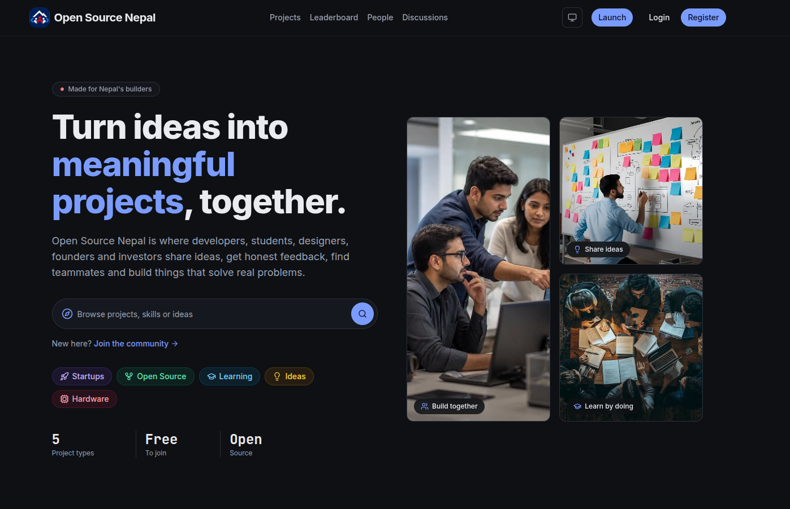
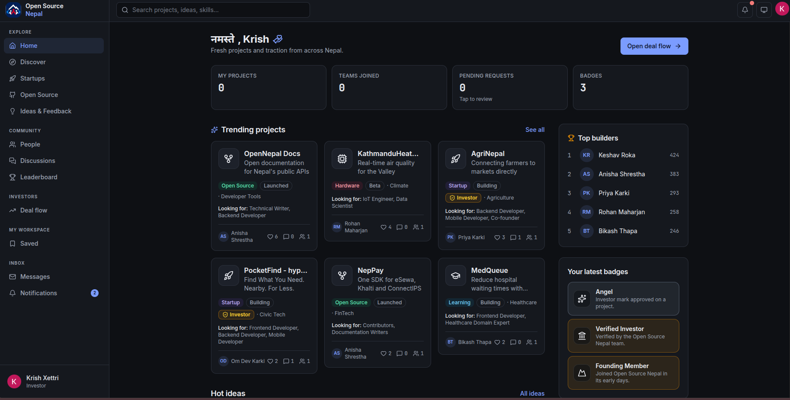
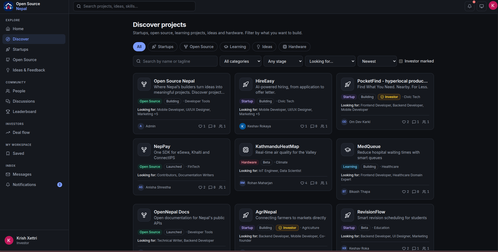
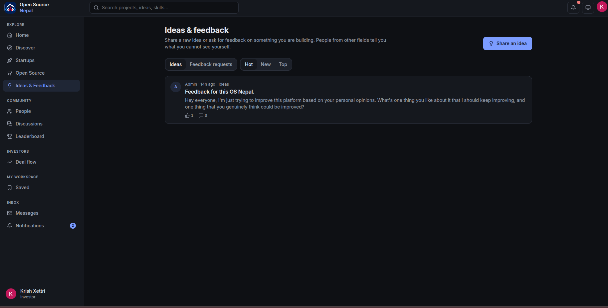
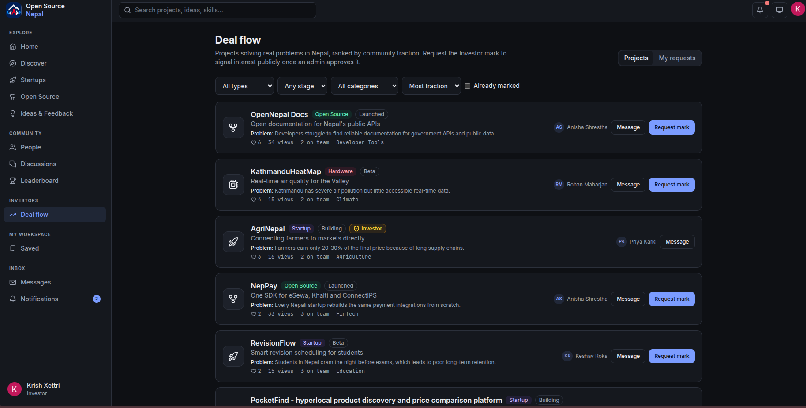

# Open Source Nepal

> A community where Nepal's builders turn ideas into meaningful projects together.

Developers, students, designers, founders and investors share ideas, get outside feedback, find teammates and build open source projects and startups. Think Product Hunt + LinkedIn + GitHub, for Nepal.

**Live site:** https://osnepal.keshavroka.com.np

## Screenshots

### Home


### Dashboard


### Discover projects


### Ideas & Feedback


### Investor deal flow



## What it does

| Need | Feature |
| --- | --- |
| "I have an idea and want outside validation" | List any project as **Startup, Open Source, Learning, Idea or Hardware**. Likes, threaded feedback, and an **Ideas & Feedback** board (built on the Ecosystem spaces). |
| "I want to contribute and learn" | **Discover** with filters (type, category, stage, *looking for*). **Request to join** a project with a role and message. |
| "I need a co-founder or a designer" | **People** directory searchable by skill, location and role. Connect and message. |
| "Prove my work in an interview" | Team members list **contributions** on a project; owners **verify** them. Your public profile (`/u/:username`) is the showcase. |
| "Who is leading?" | **Leaderboard** by period (today/week/month/all), type, category and investor mark. Builders leaderboard by reputation. |
| "Recognise progress" | **Badges** awarded automatically (First Launch, Team Player, Core Contributor, Investor Backed, ...). |
| Investors | **Deal flow** ranked by traction. Request the **Investor mark** on a project; an **admin** approves it. Only admin-*verified* investors can ask. |
| Admins | Console with stats, Investor-mark queue, investor verification, users, categories, moderation. |

Roles: `developer`, `investor`, `user`.

## Stack

| Area | Tech |
| --- | --- |
| Client (`client/`) | React 19, Vite 7, TypeScript, Tailwind v4 (design tokens in `src/styles/tokens.css`, light + dark), React Router 7, Socket.io client |
| API (`back-end/`) | Express 5 (ESM), Prisma 7 + PostgreSQL, Redis cache-aside, Socket.io, JWT in httpOnly cookies, Google OAuth, Zod |
| Deploy | Client on Vercel. API, PostgreSQL and Redis with Docker Compose behind Nginx on a VPS. CI with GitHub Actions |

## Run locally

```bash
# 1. API
cd back-end
cp .env.example .env          # set DATABASE_URL, JWT_SECRET (openssl rand -hex 48), Google keys
npm install
npx prisma migrate dev
ADMIN_EMAIL=you@example.com ADMIN_PASSWORD='a-strong-password' npm run create-admin
npm run seed:spaces           # Ideas, Feedback, Co-founder Hub, ...
npm run seed:badges
npm run dev                   # http://localhost:8000

# 2. Client
cd client
cp .env.example .env
npm install
npm run dev                   # http://localhost:3000
```


## Checks

```bash
cd back-end && npm test
```

## Where things are

```
back-end/src/modules/
  joinRequests/   request -> accept/decline -> team member + connection
  contributions/  list + owner verification
  investors/      deal flow, Investor-mark requests, admin review
  badges/         definitions + automatic awarding
  notifications/  persisted + pushed over Socket.io
  people/         directory, skills, summary
  leaderboards/   /rankings with period/type/category filters
  seo/            sitemap.xml generated from projects and profiles
client/src/
  components/shell/AppShell.tsx   sidebar + topbar, role-aware nav
  components/nepal/ui.tsx         shared building blocks
  features/nepal/                 types, API client, labels
  pages/nepal/                    Home, Discover, ProjectDetail, CreateProject, People,
                                  Leaderboard, Ideas, Profile, Workspace, Investor, Onboarding
client/public/                    robots.txt, social preview images, manifest
deploy/nginx/                     Nginx config for the API server
```

## Rules worth knowing

- Project owners can only edit whitelisted fields. `investorBacked`, `status`, counters and ownership are never accepted from the client.
- The Investor mark requires: investor account -> admin verification -> request -> admin approval. Admins can revoke it.
- Accepting a join request also creates an accepted connection so teammates can message each other.
- Reputation: +2 per like received, +5 for a join accepted (both sides), +10 per verified contribution.


## Contributing

Contributions are welcome, whether you are a student making a first pull request or an experienced developer.

1. Read [CONTRIBUTING.md](CONTRIBUTING.md).
2. Pick an issue labelled `good first issue` or `help wanted`.
3. Open a pull request with a short description of what changed and why.

## License

[MIT](LICENSE)